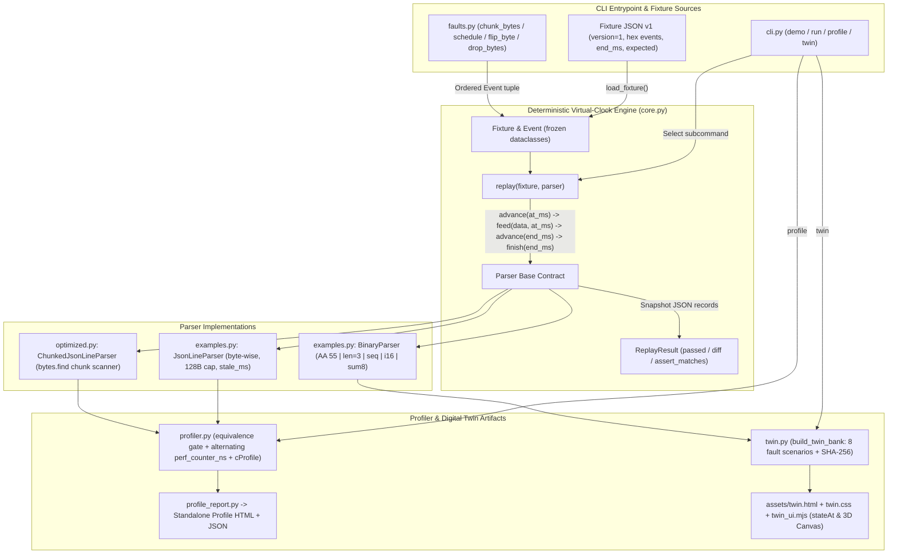
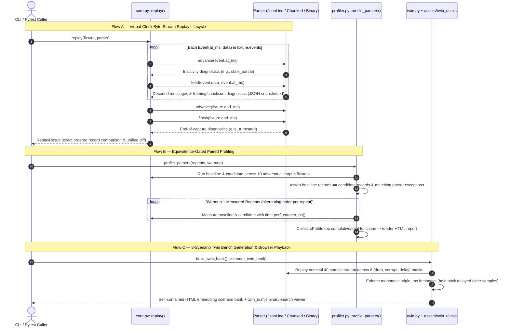

# Architecture and Source Map

## System Overview

`uart-fixture-kit` (`v0.3.0`) is a zero-runtime-dependency Python 3.10+ toolkit and offline HTML digital-twin generator for deterministic byte-stream parser testing, transport fault injection, and paired performance profiling—without serial hardware, threads, or wall-clock `sleep` calls:

1. **Deterministic Virtual-Clock Replay Core (`core.py`, `faults.py`)**: Defines immutable `Event` and `Fixture` contracts, JSON v1 hex fixture loading (`load_fixture`), pure virtual-millisecond `replay()`, and deterministic byte-stream fault transforms (`chunk_bytes`, `schedule`, `flip_byte`, `drop_bytes`).
2. **Reference & Chunk-Scanning Parsers (`examples.py`, `optimized.py`)**: Provides synthetic reference implementations (`JsonLineParser` with 128-byte line cap and 50 ms inactivity timeout, `BinaryParser` for `AA 55` 7-byte `sum8` frames with resynchronization and sequence-gap tracking, and `ChunkedJsonLineParser` scanning chunks via `bytes.find`).
3. **Equivalence-Gated Profiler (`profiler.py`, `profile_report.py`)**: Verifies exact behavioral equivalence across 10 adversarial corpus cases before running alternating `perf_counter_ns` timing repeats and `cProfile` hotspot extraction into a standalone HTML report.
4. **Offline Transport Digital Twin ("Twin Bench", `twin.py`, `assets/*`)**: Precomputes all $2^3 = 8$ combinations of deterministic transport faults (`drop`, `corrupt`, `delay` reorder) with SHA-256 provenance and bundles a self-contained Canvas 2D/3D browser replay inspector.

## System Context & Data Flow



## Execution & Pipeline Sequences



## Module Breakdown

- `src/uart_fixture_kit/__init__.py` & `__main__.py`: Public package exports (`Event`, `Fixture`, `Parser`, `ReplayResult`, `chunk_bytes`, `drop_bytes`, `flip_byte`, `load_fixture`, `replay`, `schedule`) and `python -m uart_fixture_kit` entrypoint.
- `src/uart_fixture_kit/core.py`: Strict non-boolean millisecond integer validation (`type(value) is not int`), `NaN`/`Infinity`-rejecting JSON loader (`parse_constant=_reject_constant`), defensive record snapshotting in `replay()`, and `ReplayResult` unified diffing.
- `src/uart_fixture_kit/faults.py`: Pure byte/schedule combinators validating monotonic `gaps_ms`, positive `size`, valid byte indices, and non-zero 8-bit XOR masks (`1..255`).
- `src/uart_fixture_kit/examples.py`: Reference `JsonLineParser`, `encode_binary(seq, centi_celsius)`, and `BinaryParser` (`bad_length`, `bad_checksum`, `duplicate_sequence`, `sequence_discontinuity`, `truncated`).
- `src/uart_fixture_kit/optimized.py`: `ChunkedJsonLineParser` subclassing `JsonLineParser` to replace Python per-byte iteration with `bytes.find(b"\n", offset)` while preserving identical 128-byte oversize and inactivity semantics.
- `src/uart_fixture_kit/profiler.py` & `profile_report.py`: Builds a 24,000-line multi-chunk benchmark stream plus 10 edge-case equivalence fixtures; refuses to emit timing figures if baseline and candidate diverge on any record or exception; escapes `</` for safe inline `<script>` embedding.
- `src/uart_fixture_kit/twin.py` & `src/uart_fixture_kit/assets/{twin.html,twin.css,twin_ui.mjs}`: Generates deterministic transport scenarios (including out-of-order delayed frame rejection via `origin_ms > displayed_origin`), hashes both `examples.py` and scenario JSON with SHA-256, and exports pure `stateAt()` / `project()` functions in `twin_ui.mjs` for Node contract tests.
- `src/uart_fixture_kit/cli.py`: `argparse` CLI providing `demo`, `run <fixture> --parser {json,json-chunked,binary}`, `profile`, and `twin`.

## State Management

- **Immutable Replay Inputs (`core.py`)**: `Event`, `Fixture`, and `ReplayResult` are `@dataclass(frozen=True)`. `Fixture.__post_init__` enforces monotonic `0 <= event.at_ms <= end_ms` and finite JSON serializability up front.
- **Isolated Per-Run Parser Instances**: Parsers hold bounded mutable stream state (`self.buffer: bytearray`, `self.last_byte_ms`, `self.discarding`, `self.last_seq`) for a single `replay()` call. `replay()` deep-copies every yielded `dict` via JSON round-tripping so subsequent parser mutations cannot retroactively alter previously emitted records.
- **Monotonic Freshness State (`twin.py` & `twin_ui.mjs`)**: Precomputed timeline entries record cumulative counters (`messages`, `checksum_errors`, `sequence_anomalies`, `late_ignored`) and `last_sample`. In the browser, `stateAt(scenario, milliseconds)` is a pure function using upper-bound binary search over `scenario.timeline`, deriving `'waiting' | 'fresh' | 'stale'` status without mutating scenario data.

## Local Verification & Test Commands

Run the full Python (`pytest`) and Node.js (`node:test`) verification suites from `C:\Users\ardhy\Projects\uart-fixture-kit`:

```powershell
$env:PYTHONPATH = 'src'
C:\Python314\python.exe -m pytest -q
node --test tests/*.test.mjs
```

Optional CLI smoke checks:

```powershell
$env:PYTHONPATH = 'src'
C:\Python314\python.exe -m uart_fixture_kit demo
```

## Source crosscheck, 2026-11-08

Source descriptions and proposal removed-lines were crosschecked on 2026-11-08. Test commands are retained for reproduction. Historical test counts are not a fresh run result. Fixture freezing prevents attribute rebinding but does not recursively freeze its expected list.
