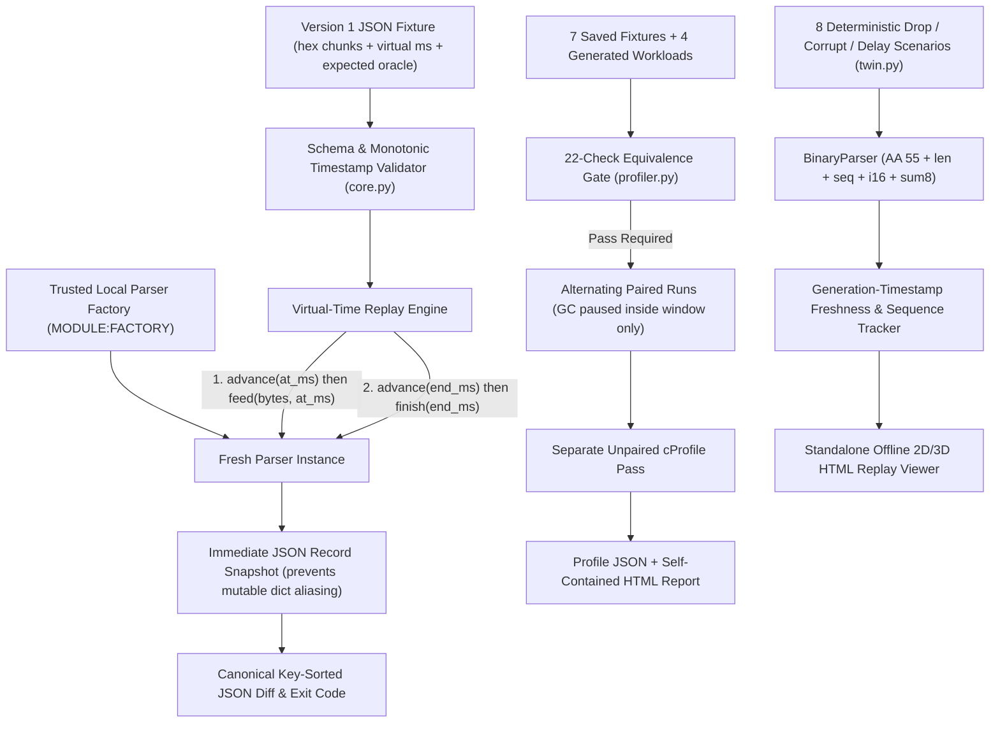

# UART Fixture Kit

Deterministic byte-stream replay, correctness-gated parser profiling, and synthetic receiver fault inspection for serial protocols—without attached hardware.

[](LICENSE)


Serial `read()` calls rarely align with application message boundaries. A single read can split a frame across two callbacks, concatenate multiple frames, interleave line noise with a valid header, or stall mid-packet past an inactivity deadline. Whole-line unit tests miss those state-machine transitions.

**UART Fixture Kit** captures the exact byte-stream and virtual-clock contract in portable JSON fixtures, replays them deterministically against any Python parser adapter, gates throughput profiling behind strict equivalence checks, and exports an offline 8-scenario receiver fault timeline.

---

## Core Capabilities & Boundaries

| Capability | What It Does | Explicit Scope Boundary |
|---|---|---|
| **Deterministic Stream Replay** | Feeds exact hex chunks at ordered virtual millisecond ticks (`advance` -> `feed` -> `finish`) and compares JSON-snapshotted outputs against an explicit oracle. | Virtual timestamps drive parser timeout logic instantly; replay does not sleep in wall-clock time or validate physical baud-clock tolerance. |
| **Correctness-Gated Profiler** | Verifies 22 fixture/workload equivalence checks before timing `JsonLineParser` vs. `ChunkedJsonLineParser` with alternating run order and isolated `cProfile`. | Measures Python byte-buffering and dispatch overhead on a specific host—not physical UART wire speed or DMA latency. |
| **Synthetic Fault Twin** | Simulates all $2^3 = 8$ combinations of deterministic frame drop, payload/checksum corruption, and `350 ms` arrival delay, tracking sample staleness from generation time. | Visualizes precomputed software receiver state; not calibrated to a physical transceiver or noisy cable. |

---

## System Architecture



---

## Quick Start

Install directly from the tagged GitHub release (no third-party runtime packages are installed):

```console
python -m pip install "git+https://github.com/vanovri/uart-fixture-kit.git@v0.3.0"
python -m uart_fixture_kit demo
python -m uart_fixture_kit demo --json
```

`uart-fixture-kit` is registered as a console script and is identical to `python -m uart_fixture_kit`. Using `python -m` avoids `PATH` ambiguity across virtual environments.

The bundled `demo` replays 15 synthetic newline-JSON and binary protocol fixtures covering split headers, coalesced bursts, malformed JSON, non-finite numbers, `>128`-byte line overflows, `50 ms` stale partial frames, truncated payloads, bad `sum8` checksums, noise resynchronization, duplicate sequence suppression, and `255 -> 0` sequence wraparound.

---

## Authoring a Fixture & Parser Adapter

Save `split-line.json`:

```json
{
  "version": 1,
  "name": "split-line",
  "events": [
    {"at_ms": 0, "hex": "4f"},
    {"at_ms": 1, "hex": "4b0a"}
  ],
  "end_ms": 2,
  "expected": [{"line": "OK"}]
}
```

Save `my_adapter.py` in the same directory:

```python
from uart_fixture_kit import Parser


class BufferedLineParser(Parser):
    def __init__(self) -> None:
        self.pending = bytearray()

    def feed(self, data: bytes, now_ms: int) -> list[dict]:
        self.pending.extend(data)
        emitted: list[dict] = []
        while b"\n" in self.pending:
            line, _, remainder = self.pending.partition(b"\n")
            self.pending[:] = remainder
            emitted.append({"line": line.decode("utf-8")})
        return emitted
```

Execute from the command line or inside `pytest`:

```console
python -m uart_fixture_kit run split-line.json --parser my_adapter:BufferedLineParser
```

```python
from uart_fixture_kit import load_fixture, replay
from my_adapter import BufferedLineParser


def test_split_line_contract() -> None:
    result = replay(load_fixture("split-line.json"), BufferedLineParser())
    result.assert_matches()
```

### Replay Contract Rules
- **Fresh state per run:** Always pass a new parser instance to `replay()`.
- **Optional lifecycle hooks:** Override `advance(now_ms)` to emit inactivity timeout diagnostics before incoming bytes arrive at `now_ms`, and `finish(now_ms)` to flush or report truncated trailing bytes at end-of-stream.
- **Zero-byte timer ticks:** An event with `"hex": ""` advances virtual time without feeding bytes, letting fixtures test exact timeout boundaries.
- **Strict JSON typing:** Boolean timestamps (`true`/`false`) and non-finite floats (`NaN`/`Infinity`) are rejected. Record comparison preserves array order and numeric JSON spelling (`1` vs `1.0`).

---

## CLI Reference & Exit Codes

```console
# 1. Bundled reference suite
python -m uart_fixture_kit demo [--json]

# 2. Custom adapter verification
python -m uart_fixture_kit run FIXTURE.json --parser MODULE:FACTORY [--json]

# 3. Correctness-gated parser profiler
python -m uart_fixture_kit profile --records 2048 --repeats 9 --warmups 3 --output uart-profile.json --html uart-profile.html

# 4. Eight-scenario synthetic fault twin
python -m uart_fixture_kit twin --frames 120 --output uart-twin.html --json-output uart-twin.json
```

| Subcommand | Key Bounds & Flags | Audit Note (`v0.3.0`) |
|---|---|---|
| `profile` | `--records` (`1..10000`, default `2048`), `--repeats` (`3..31`, default `7`), `--warmups` (`1..10`, default `2`), `--output`, `--html` | Supply **distinct** paths for `--output` and `--html`; both `profile` and `twin` reject identical resolved paths (`exit code 2`). |
| `twin` | `--frames` (`12..240`, default `120`), `--output`, `--json-output` | Generates all 8 combinations of drop (every 5th frame), corrupt (every 7th retained), and `350 ms` delay (every 6th retained). |

| Exit Code | Meaning |
|---:|---|
| `0` | All replay expectations matched, profiler correctness gate + export succeeded, or twin export succeeded. |
| `1` | Emitted parser records diverged from `expected`, or profiler candidate failed equivalence gate. |
| `2` | Malformed fixture schema, invalid CLI arguments, `ImportError`/`AttributeError` loading factory, or handled I/O error. |

---

## Correctness-Gated Profiling & Negative-Case Transparency

`ChunkedJsonLineParser` (`optimized.py`) replaces byte-by-byte buffer scanning with chunk-level newline search while checking the `128`-byteunfinished-line ceiling *before* slicing. Rather than claiming a universal speedup, `profiler.py` enforces 22 equivalence checks first and tests four distinct arrival geometries.

Archived sample (`docs/profile-sample.json`, recorded on Windows / CPython `3.14.7`, `2,048` records, `9` repeats, `3` warm-ups):

| Arrival Workload (`76,739` payload bytes except recovery) | `JsonLineParser` Median | `ChunkedJsonLineParser` Median | Ratio (`Ref / Opt`) | Engineering Interpretation |
|---|---:|---:|---:|---|
| Bulk chunks up to `4,096 B` | `18.368 ms` | `8.669 ms` | **`2.12x`** | Fewer Python loop iterations across large DMA/OS read buffers. |
| Fragmented `1 / 2 / 7 / 3 B` cycle | `27.723 ms` | `26.099 ms` | **`1.06x`** | Modest gain when frames still span multiple tiny reads. |
| Pathological `1-byte` arrival events | `44.280 ms` | `56.507 ms` | **`0.78x` (slower)** | Per-call chunk bookkeeping dominates single-byte dispatch; `JsonLineParser` remains package default. |
| Fault & overflow recovery (`128 B` cap + stale ticks) | `0.064 ms` | `0.046 ms` | **`1.38x`** | Early length guard avoids copying oversized unfinished lines. |

---

## Development & Verification

```console
git clone https://github.com/vanovri/uart-fixture-kit.git
cd uart-fixture-kit
python -m venv .venv
# Windows: .venv\Scripts\activate | Linux/macOS: source .venv/bin/activate
python -m pip install -e ".[dev]"

python -m pytest -q
node --test tests/twin.test.mjs
python -m build
```

- **Verified Local Audit (7 November 2026):** `248` Python tests passed (`CPython 3.14.7`) and `5` Node viewer tests (`tests/*.test.mjs`) passed (`Node v24.20.0`). *(Note: 8 tests in `tests/test_fault_injection_and_interview_drills.py` exercise a self-contained CRC drill parser for protocol education rather than shipped package modules.)*
- **CI Matrix:** `.github/workflows/` runs `pytest`, Node viewer checks, wheel build, and installed-wheel CLI smoke tests across Windows and Ubuntu on Python `3.10`, `3.12`, and `3.14`.

---

## Security & Trust Model

- **Trusted Adapter Code:** `--parser MODULE:FACTORY` imports and executes local Python code with caller privileges. It is a test runner, **not** an untrusted-code sandbox.
- **Memory Bounds:** `load_fixture()` reads the full JSON document into memory; apply OS/container limits if validating huge externally supplied files.
- **Checksum Scope:** Reference `BinaryParser` uses modulo-256 `sum8` for framing education—use CRC-16/CRC-32 or authenticated framing in production hardware protocols.
- **Provenance:** All bundled fixtures are 100% synthetic (zero human subject recordings or proprietary captures). Built with AI coding assistance and verified via deterministic assertions; see [`docs/PROVENANCE.md`](docs/PROVENANCE.md) and [`LICENSE`](LICENSE).
