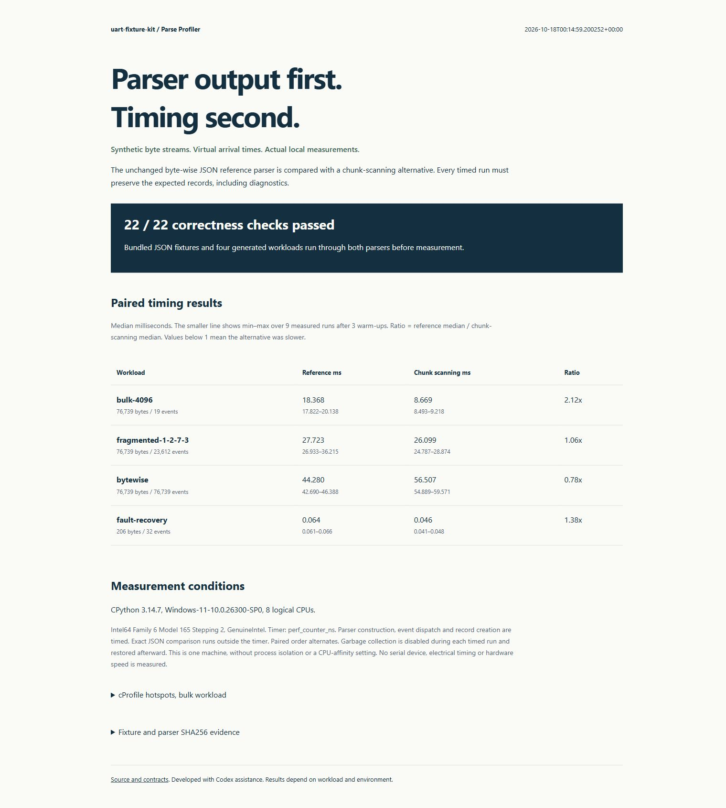
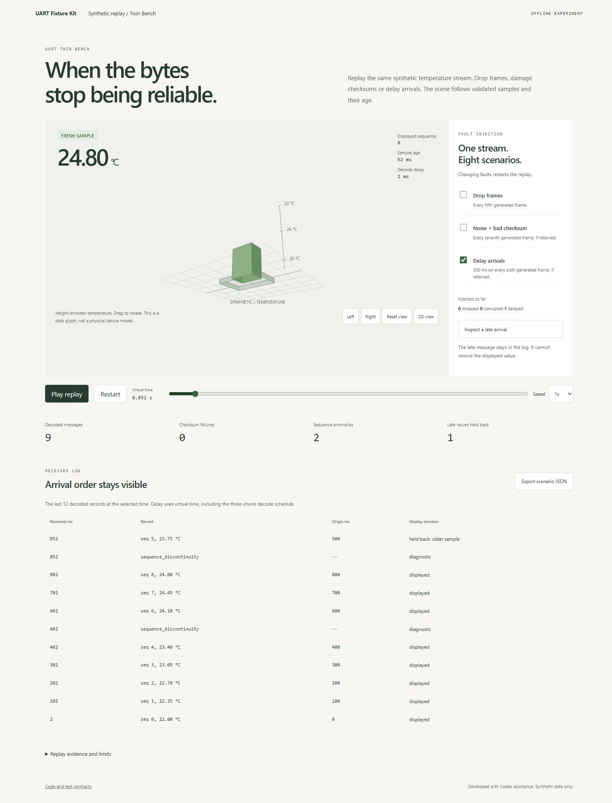

# uart-fixture-kit

[](https://github.com/vanovri/uart-fixture-kit/actions/workflows/tests.yml)

Reproduce byte-stream parser bugs without a serial device. Save raw bytes, their virtual arrival times, and expected records in JSON. Replay the same fixture against your own Python parser in pytest or from the command line.

A serial read can return half a message, several messages, or noise followed by a valid frame. A parser that works with complete lines can still fail when those lines arrive in chunks. This toolkit makes that failure small, repeatable, and reviewable.

## Try it

Python 3.10 or newer. No runtime dependencies, API keys, GPU, or hardware.

```console
python -m pip install "git+https://github.com/vanovri/uart-fixture-kit.git@v0.3.0"
uart-fixture-kit demo
uart-fixture-kit demo --json
```

The demo runs bundled synthetic cases for newline JSON and a small binary protocol: complete, fragmented and concatenated messages, malformed JSON, invalid values and units, oversized lines, EOF truncation, stale partial input, bad frame length, checksum failure, resynchronization, duplicate sequence and sequence wraparound.

GitHub is the distribution source for this release. This package has not been published on PyPI.

## UART Parse Profiler

Version 0.2 adds a chunk-scanning JSON alternative without changing the byte-wise reference parser or the default demo. Measure both against the same synthetic input and virtual timestamps:

```console
uart-fixture-kit profile --records 2048 --repeats 9 --warmups 3 --output uart-profile.json --html uart-profile.html
```

Open the HTML file for the timing table and cProfile hotspots. JSON keeps every timing sample, environment details, source hashes and a manifest covering input bytes, timestamps and expected records. Seven saved JSON fixtures and four generated workloads must match their explicit record oracles on both parsers before timing. Each timed run is checked again outside the timer. No network connection or serial hardware is required.

One Windows/CPython 3.14.7 run on 18 October 2026 measured the following medians over nine paired repeats:

| Synthetic workload | Reference ms | Chunk scanning ms | Reference / candidate |
| --- | ---: | ---: | ---: |
| 76,739 bytes in 4,096-byte chunks | 18.368 | 8.669 | 2.12x |
| The same stream, repeating chunks 1/2/7/3 | 27.723 | 26.099 | 1.06x |
| The same stream, one byte per event | 44.280 | 56.507 | 0.78x |
| Malformed, oversized, stale and partial input recovery | 0.064 | 0.046 | 1.38x |

The alternative was **slower for byte-by-byte arrival**. The smaller difference on fragmented input may be sensitive to measurement noise. These are parser/event-dispatch measurements on one machine, not UART link speed or a general performance guarantee. The original parser remains the default. See [methodology and exact replay](docs/PROFILING.md), [recorded JSON](docs/profile-sample.json) and [standalone HTML](docs/profile-sample.html).



## UART Twin Bench

Version 0.3 adds an offline, self-contained receiver replay with a projected 3D
temperature glyph. Generate all eight combinations of whole-frame loss, checksum
damage/noise, and delayed arrivals using the existing binary reference parser:

```console
uart-fixture-kit twin --frames 120 --output uart-twin.html --json-output uart-twin.json
```

Open the HTML file, select faults, play or seek the virtual clock, and inspect
the arrival log. The late-arrival example decodes sequence 5 at 852 ms after
sequence 8 is already displayed. It stays in the log without rewinding the display
or refreshing its age. Samples become stale 300 ms after generation, including
at the end of the replay. Exported JSON preserves generated frames, injected
faults, received byte chunks, decoded records, timeline, and hashes.



See [the standalone demo](docs/twin-sample.html). Python computes the receiver
timeline; the browser selects and visualizes it. The scene is a data glyph, not
a hardware digital twin. Timings and Celsius values are synthetic. No device,
serial connection, physiological model, or physical reliability claim is involved.
The known injection count is distinct from sequence anomalies observed by the
receiver. Sum8 is a demonstration checksum, not a CRC or authentication check.

## Catch a real class of bug

This fixture delivers `OK\n` in two reads:

```python
from uart_fixture_kit import Event, Fixture, Parser, replay

fixture = Fixture(
    name="split-line",
    events=(Event(0, b"O"), Event(1, b"K\n")),
    end_ms=2,
    expected=[{"line": "OK"}],
)

class Broken(Parser):
    def feed(self, data, now_ms):
        # Mistake: assume every read contains complete lines.
        return [{"line": part.decode()} for part in data.splitlines()]

result = replay(fixture, Broken())
assert not result.passed  # Actual records: O, K. Expected: OK.
print(result.diff)
```

Keep unfinished bytes between reads:

```python
class Buffered(Parser):
    def __init__(self):
        self.pending = bytearray()

    def feed(self, data, now_ms):
        self.pending.extend(data)
        records = []
        while b"\n" in self.pending:
            line, _, remainder = self.pending.partition(b"\n")
            self.pending[:] = remainder
            records.append({"line": line.decode()})
        return records

replay(fixture, Buffered()).assert_matches()
```

## Test your existing parser

Subclass `Parser` and adapt your parser's decoded messages to JSON object records. The toolkit does not impose a wire format or decide which bytes are valid for your application.

```python
from uart_fixture_kit import Parser, load_fixture, replay

class Adapter(Parser):
    def __init__(self):
        self.decoder = YourExistingDecoder()

    def feed(self, data, now_ms):
        return [{"value": message.value} for message in self.decoder.feed(data)]

def test_uart_contract():
    replay(load_fixture("tests/fixtures/split-message.json"), Adapter()).assert_matches()
```

For a CLI adapter, put a zero-argument factory or class in an importable module:

```console
uart-fixture-kit run tests/fixtures/split-message.json --parser my_adapter:Adapter --json
```

The adapter runs as ordinary trusted local Python code. Only run adapter modules you trust. Fixture JSON supplies bytes and expected data, never executable code.

## Fixture format

```json
{
  "version": 1,
  "name": "split-line",
  "events": [
    {"at_ms": 0, "hex": "4f"},
    {"at_ms": 1, "hex": "4b0a"}
  ],
  "end_ms": 2,
  "expected": [{"line": "OK"}]
}
```

- `hex` holds the exact received bytes. Spaces are allowed.
- Times are non-negative integer milliseconds, ordered, and no later than `end_ms`. Equal arrival times are allowed; list order is preserved.
- `advance(now_ms)` runs before each `feed(data, now_ms)` and again at `end_ms`. An event with empty `hex` is an explicit timer tick. No real time passes.
- `finish(end_ms)` runs once. Override it to report incomplete data at EOF.
- Every method emits zero or more JSON object records. `advance` and `finish` default to no output.
- Expected records compare exactly, in order, using sorted-key JSON. Numeric spelling such as `1` versus `1.0` differs; object key order does not. Non-finite values are rejected.
- A fresh parser instance is required for each replay. Parser exceptions retain their tracebacks through the Python API.

CLI exit codes: `0` all contracts match, `1` records differ, `2` fixture/import/report error. Unexpected parser exceptions exit with a traceback.

## Build fault cases

```python
from uart_fixture_kit import chunk_bytes, drop_bytes, flip_byte, schedule

chunks = chunk_bytes(b"OK\nREADY\n", [1, 2, 3])  # Repeating explicit sizes.
events = schedule(b"OK\n", [1], interval_ms=10)
corrupted = flip_byte(b"abc", offset=1, mask=1)
missing = drop_bytes(b"abc", offset=1, count=1)
```

These helpers have no random state. Store the resulting hex and arrival times in a fixture to share a failure. Duplicate input by inserting the same event or frame twice.

## Reference examples and limits

`JsonLineParser` accepts newline-delimited synthetic temperature records with `seq` 0..255, a finite numeric `value`, and `unit: "C"`. It limits unfinished lines to 128 bytes and uses a 50 ms inactivity timeout. Timer diagnostics occur at the supplied virtual ticks, not necessarily at the physical threshold instant.

`BinaryParser` uses a demonstration frame: `AA 55 | length=3 | sequence:u8 | centi-C:i16 little-endian | sum8`. The checksum covers length and payload modulo 256. It rejects wrong lengths/checksums, suppresses immediately repeated sequence numbers, and accepts 255-to-0 wraparound. A sequence discontinuity indicates a change in sequence, not proof of packet loss. Sum8 is not a CRC or authentication mechanism.

Both examples are deliberately small. They are not production telemetry standards, device drivers, or clinical software. Fixtures use synthetic bytes only. Software replay cannot validate UART electrical behavior, baud-rate accuracy, ADC timing, hardware reliability, or device safety.

## Development

```console
git clone https://github.com/vanovri/uart-fixture-kit.git
cd uart-fixture-kit
python -m venv .venv
# Windows: .venv\Scripts\activate
# Linux/macOS: source .venv/bin/activate
python -m pip install -e ".[dev]"
python -m pytest
python -m build
```

Tests include a failing broken-parser regression, every two-chunk split of representative streams, byte-by-byte corruption recovery, timer boundary cases, CLI exit codes, fixture validation, and installed-package demo checks. CI runs on Windows and Linux across Python 3.10, 3.12, and 3.14.

Profiler tests also cover the 127/128/129-byte line boundary, mixed invalid input, empty-feed timeout behavior, bounded oversized partial input, rejection of an incorrect candidate before timing, raw-sample reports and the installed-wheel CLI.

## Related tools

[pySerial](https://pyserial.readthedocs.io/en/latest/) provides serial transport and loopback facilities. [Serial Studio](https://github.com/Serial-Studio/Serial-Studio) provides telemetry visualization and capture/replay. [WireDAQ](https://github.com/wuisabel-gif/WireDAQ) includes its own wire protocol and fault simulation. This project focuses on a small fixture contract for adapters to existing parsers. Replay and fault injection are established techniques.

## Contribute

Bring a minimal synthetic failing fixture and its expected output. See [CONTRIBUTING.md](CONTRIBUTING.md). MIT licensed. Initial implementation was created with AI coding assistance and checked by executable tests; no claim of entirely human-written code.
